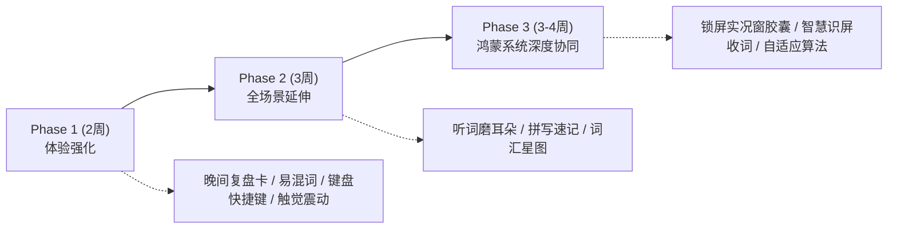

# 词萤 · LexiGlow
## 背单词软件功能丰富与体验升级完整技术方案 (V1.5 ~ V2.0)

> **文档版本**：V1.5 (2026 年 10 月)  
> **适用平台**：HarmonyOS API 26 / Stage 模型 / ArkTS  
> **核心愿景**：让单词一点一点亮起来  
> **配套 Word 文件**：`docs/词萤_LexiGlow_软件功能丰富与体验升级完整方案.docx`

---

## 0. 方案摘要与升级定位

词萤是一款面向学生的“低压力、强复习、碎片化”背单词应用。当前 V1.0 版本已经奠定了扎实的原生离线品质（RDB 事务原子回滚、纯函数间隔调度器、26,071 词条离线五大词书、DOCX/CSV 全格式导入、API 26 原生沉浸光感与多端自适应布局）。

本次方案升级聚焦于**“在不破坏极简、低压力初衷的前提下，击穿学生背词痛点，覆盖全场景学习需求”**：
1. **记忆深度深化**：解决“总记不住、易混淆、只会认不会拼”的真实学习痛点；
2. **场景维度拓展**：覆盖“睡前 30 秒无痛复盘”与“通勤闭眼听词磨耳朵”全天候作息；
3. **鸿蒙生态赋能**：打通锁屏与实况窗（Live View）胶囊、自习室全键盘盲操、物理触觉震动引擎；
4. **品牌情感共鸣**：将“萤火点亮”具象化为动态“词汇星图”，以温和的补光机制代替焦虑断签。

---

## 一、 当前工程评估与升级指标

| 模块 | 当前 V1.0 状态 | V1.5 ~ V2.0 升级目标 |
| :--- | :--- | :--- |
| **数据持久化** | ArkData RDB 单事务原子提交、崩溃回滚 | 升级至 Schema V3，增量支持易混词库、词根关系、反应时异动统计 |
| **词库与释义** | ECDICT 5 本离线词书（10,689 独立词头） | 补充真题核心考点义项、动宾搭配（Collocations）及形近词辨析 |
| **复习与调度** | 纯函数间隔调度（10m ~ 60d）、记忆强度 0~100 | 引入答题反应时长（`response_ms`）犹豫惩罚微调与长期稳定性加成 |
| **学习场景** | 单词卡自评、中文释义挑战、3 分钟速学 | 新增【睡前 30 秒过电影】、【后台听词磨耳朵】、【拼写速记挑战】 |
| **鸿蒙原生能力** | 沉浸光感、2x2/2x4 桌面卡片、多端 840vp 适配 | 新增【锁屏与实况窗胶囊】、【平板/2in1 全键盘盲操】、【微动触觉震动】 |
| **激励系统** | 连续天数、掌握词数折线、28 天日历 | 新增【萤火词汇星图可视化】、【温暖无痛补光机制】（告别断签焦虑） |

---

## 二、 核心背词体验深化（击穿记忆痛点）

### 2.1 “我为什么总忘这个词？”—— 错词病历与易混辨析
1. **反应时长异动预警**：
   - 充分利用数据表 `review_record` 中的 `response_ms` 字段。
   - 当单词在复习中连续 2 次被标记为“模糊”，或答题耗时超过 3500ms 时，系统自动归类为“犹豫词”，在词卡右上角浮现微光警示。
2. **形近/易混词（Confusing Pairs）对比展开卡**：
   - 针对四六级与考研的高频易混对（如 `adapt / adopt / adept`、`complement / compliment`、`stationary / stationery`）。
   - 词卡背面提供【⚠️ 易混辨析】可折叠栏，一键并列展示发音、核心义项与典型短语差异，打破混淆假象。
3. **针对性纠错优先调度**：
   - 当日多次答错的生词，在次日计划生成时优先排在队列前列，防止错题堆积。

### 2.2 词根词缀与派生星图（Word Family）
1. **词根拆解分析**：
   - 在释义下方提供【词根解析】折叠栏。例如 `distract`：`dis-` (分离) + `tract` (拉/引) $\to$ 将注意力拉走 $\to$ 分散注意力。
2. **派生词家族互联**：
   - 展示同根词簇（如 `attract`, `contract`, `extract`, `retract`）。
   - 若派生词已在用户词库中，直接显示其当前记忆强度颜色（红/橙/黄/绿），点击可直接无缝穿透查看。

### 2.3 真题考点与高频搭配（Collocations）
- **高频动宾搭配**：如 `abandon the attempt`（放弃尝试）、`heavily rely on`（严重依赖）。
- **考点义项高亮**：对熟词生义（如 `address` 考“解决/演说”，`novel` 考“新颖的”）进行置顶高亮标注，避免在非考点义项上浪费时间。

---

## 三、 多元碎片化场景扩展（覆盖全天作息）

### 3.1 晚间 30 秒睡前复盘（Night Flash）
- **核心理念**：零操作、零选择、零考核压力。
- **触发规则**：每天 21:00 之后，首页出现【晚间 30 秒过电影】入口。
- **交互流程**：
  - 仅挑选出当天标记为“不认识”或“模糊”的 Top 3~5 个生词；
  - 界面采用极暗柔和夜间模式；
  - 每张卡片自动停留 4 秒：`英文单词 -> 核心词性释义 -> 提示助记`，自动平滑淡入淡出轮播；
  - 结束后轻柔提示：*“今天的生词已温习完毕，晚安”*。

### 3.2 通勤与闭眼“听词磨耳朵”（Audio Flow）
依托已集成的 Core Speech Kit 离线语音能力，覆盖排队、挤地铁、晨间洗漱等无法看屏幕的场景：
- **音频播放时序流**：
  1. `0.0s ~ 1.0s`：英文单词朗读（1.0x 正常语速）
  2. `1.0s ~ 2.5s`：静音停顿 1.5 秒（留出回忆中文释义的黄金窗口）
  3. `2.5s ~ 4.0s`：中文核心释义朗读
  4. `4.0s ~ 6.5s`：英文原声典型例句朗读
  5. `6.5s ~ 7.5s`：微音效转场，切入下一词
- **系统生态接入**：对接 HarmonyOS `MediaSession` 播控中心，在锁屏界面支持上一词、暂停、下一词及蓝牙耳机按键控制。

### 3.3 拼写速记挑战（Spell Rush）
- **针对痛点**：四六级翻译和考研写作“提笔忘字”；
- **练习机制**：给出中文释义和首尾字母槽位（如 `a _ _ _ _ _ _ e` $\to$ `acknowledge`），用户从底部乱序字母气泡中点击或全键盘键入；
- **局制与计分**：5 词一局，90 秒极速结束，独立记录练习得分，不增加日常复习负担。

---

## 四、 HarmonyOS 系统级原生体验深度赋能

### 4.1 锁屏与实况窗（Live View）打通
- **锁屏胶囊态**：在锁屏状态栏和 AOD 息屏常显上显示当前推荐单词与音标，亮屏即见；
- **展开交互卡片**：轻触锁屏胶囊展开为轻量词卡，双击直接查看释义，**免除解锁屏幕和寻找 App 图标的操作摩擦**。

### 4.2 平板与 2in1 全键盘盲操支持（自习室生产力）
结合已实现的 840vp 宽屏与 2in1 布局，为连接物理键盘的用户提供极致吞吐率：

| 按键映射 | 触发动作 | 对应触控操作 |
| :--- | :--- | :--- |
| **Space / Enter** | 显示释义 / 翻转卡片 | 点击【显示释义】按钮 |
| **1  或  J** | 标记【不认识】(Forget) | 点击底部【不认识】 |
| **2  或  K** | 标记【模糊】(Fuzzy) | 点击底部【模糊】 |
| **3  或  L** | 标记【认识】(Know) | 点击底部【认识】 |
| **P  或  R** | 重播单词发音 (Play Audio) | 点击发音喇叭图标 |
| **S** | 加入 / 取消生词本 (Star) | 点击右上角收藏星标 |
| **Esc** | 暂存进度并退出到首页 | 点击左上角返回 |

### 4.3 物理触觉引擎（Haptics Engine）
调用 HarmonyOS `Vibrator` API，打造纸质卡片般的真实触觉：
- **翻开释义**：触发 15ms 微弱阻尼震动（纸张翻动感）；
- **标记认识**：触发清脆短促的点震（确认感）；
- **完成当日目标**：两段式节奏轻震，配合屏幕萤光聚拢动效。

### 4.4 智慧识屏与全局生词收入插件
在华为浏览器或阅读英文 PDF 时，长按选词，系统上下文菜单提供【词萤收词】快捷项。点击后后台无感调用 RDB 将其加入生词本，并匹配本地离线释义。

---

## 五、 视觉情感化：“词萤”意象与激励进阶

### 5.1 “萤火星图”（Vocabulary Constellation）可视化
- **隐喻具象化**：在【统计】页提供【词汇星图】视图。
- **动态光点**：每个学过的词是一枚微光粒子：
  - 陌生（0~24）：微弱冷灰点
  - 模糊（25~49）：浅橙光点
  - 熟悉（50~74）：淡黄光点
  - 掌握（75~100）：璀璨萤光金点
- **语意连线**：同词根或同分类的词达到【掌握】时，彼此浮现半透明淡金连线，直观感受知识网络由点及面。

### 5.2 温暖无痛的“补光”机制（告别断签焦虑）
- **反焦虑哲学**：断签不以红色警告或大字羞辱，未学习日期在日历上显示为微暗光环，标记为“等待重新点亮”；
- **次日自然补光**：只要次日多背 5 个词或完成复习，前一天暗掉的光点自动重新点亮，文案提示：*“用今天的光，温暖了昨天遗漏的记忆”*。

---

## 六、 技术演进与架构落地设计

### 6.1 数据库架构增量升级方案 (`SCHEMA_VERSION = 3`)
向后兼容平滑升级，保障用户历史进度无损：
```sql
-- 1. 新增词根词缀分析表
CREATE TABLE IF NOT EXISTS word_etymology (
  word_id INTEGER PRIMARY KEY,
  root TEXT,
  prefix TEXT,
  suffix TEXT,
  analysis TEXT NOT NULL,
  family_words TEXT,
  FOREIGN KEY(word_id) REFERENCES word(id)
);

-- 2. 新增易混词关系表
CREATE TABLE IF NOT EXISTS confusing_words (
  id INTEGER PRIMARY KEY AUTOINCREMENT,
  word_id INTEGER NOT NULL,
  paired_word_id INTEGER NOT NULL,
  distinction_note TEXT NOT NULL,
  FOREIGN KEY(word_id) REFERENCES word(id),
  FOREIGN KEY(paired_word_id) REFERENCES word(id)
);

-- 3. 进度表扩充犹豫度特征
ALTER TABLE word_progress ADD COLUMN hesitation_count INTEGER NOT NULL DEFAULT 0;
ALTER TABLE word_progress ADD COLUMN last_response_ms INTEGER NOT NULL DEFAULT 0;
```

### 6.2 算法进阶：自适应动态调度微调
- **犹豫惩罚微调**：若 `response_ms > 4000ms` 且判断为 `KNOW`，强度仅增加 8 点（原为 12 点），下次间隔缩短 20%，防范犹豫蒙对；
- **高稳定加成**：连续 3 次判定为 `KNOW` 且间隔超过 14 天的单词，基础间隔倍率由 2.0x 上调至 2.4x。

---

## 七、 分阶段落地路线图



| 阶段 | 周期 | 核心交付成果 | 预期收益 |
| :--- | :--- | :--- | :--- |
| **Phase 1: 体验强化** | 2 周 | 晚间 30 秒睡前复盘卡、易混词辨析卡、2in1/平板全键盘快捷键、触觉震动引擎 | 极低重构代价，成倍提升每日学习手感与自习室效率 |
| **Phase 2: 场景延伸** | 3 周 | 闭眼听词磨耳朵（MediaSession）、拼写速记挑战（Spell Rush）、词汇星图 Canvas 可视化 | 突破单一视觉翻卡场景，覆盖听、写全维度学习需求 |
| **Phase 3: 系统协同** | 3~4 周 | 锁屏与实况窗胶囊适配、智慧识屏全局生词收入、自适应犹豫度调度优化 | 打造 HarmonyOS 生态中兼具工业级品质与极佳口碑的标杆应用 |
